# studio_stadio

**Un estudio en el navegador para dibujar, ejecutar y depurar agentes de LangGraph: montas el grafo con cajas y flechas, lo lanzas, ves cada paso en directo y puedes volver a cualquier punto de la ejecución, cambiar un valor y seguir por otra rama. Todo en local con Ollama, sin LangSmith ni cuentas en la nube.**


Le pides al flujo «Escritor con autocrítica» un párrafo sobre *«Hernán Cortés y la caída de Tenochtitlan»* y esto es lo que queda en pantalla al terminar:

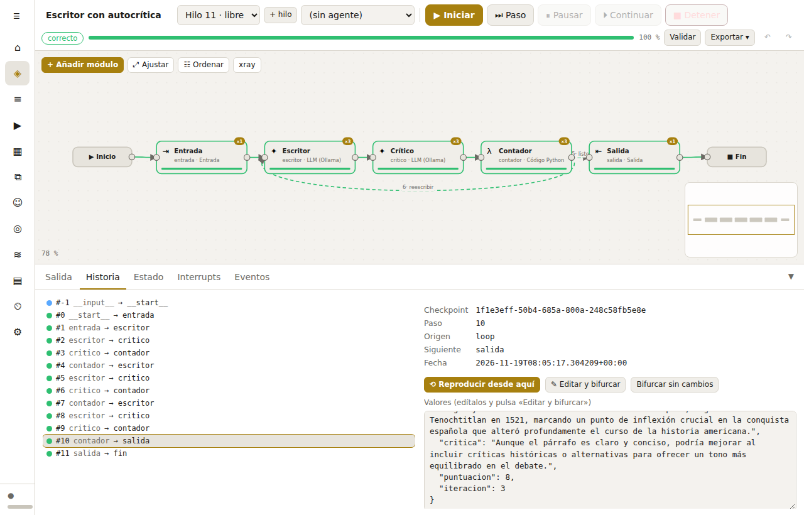

Un LLM escribe, otro lo puntúa en JSON y una arista condicional devuelve el texto al escritor mientras la nota no llegue a 8: aquí hicieron falta tres vueltas (`×3` en los nodos). El grafo no está escrito en Python: es un JSON que el estudio compila a un `StateGraph` de LangGraph en cada ejecución, y cada uno de los 13 checkpoints del panel Historia se puede abrir, editar y relanzar.

## Qué demuestra este proyecto

| Capacidad | Cómo está resuelta | Dónde |
|---|---|---|
| **Compilar un grafo visual a LangGraph** | `build()` convierte nodos y aristas en un `StateGraph` real: aristas condicionales (expresiones evaluadas con *builtins* restringidos), joins, ciclos, `Send`/`Command`, `RetryPolicy`, `TimeoutPolicy` y `CachePolicy` | [`compiler.py`](demo/studio/compiler.py) |
| **Ejecución en directo** | `astream` con los modos `updates`, `custom`, `checkpoints` y `messages` (subgrafos incluidos) → eventos normalizados que llegan al navegador por SSE y se guardan en SQLite | [`engine.py`](demo/studio/engine.py), [`server.py`](demo/studio/server.py) |
| **Depuración con checkpoints** | `AsyncSqliteSaver`: historia de cada hilo, reproducir desde un checkpoint, editar el estado y bifurcar con `aupdate_state`, pausa al final de un *superstep* y *breakpoints* | [`server.py`](demo/studio/server.py), [`static/views/estudio.js`](demo/studio/static/views/estudio.js) |
| **Human-in-the-loop** | `interrupt()` con `response_schema` en el nodo de revisión y en la herramienta `pedir_confirmacion`; la GUI pinta el formulario y reanuda con `Command(resume=…)` | [`revision_humana.py`](demo/studio/modules/revision_humana.py), [`tools/confirmar.py`](demo/studio/modules/tools/confirmar.py) |
| **Agente con herramientas y memoria** | Subgrafo LLM ⇄ `ToolNode` con `tools_condition` sobre `ChatOllama.bind_tools`; herramientas propias, de servidores MCP (`langchain-mcp-adapters`) u otros flujos; memoria a largo plazo en `AsyncSqliteStore` con embeddings de `nomic-embed-text` | [`compiler.py`](demo/studio/compiler.py) (`_build_agent`), [`modules/tools/`](demo/studio/modules/tools/), [`mcp_cliente.py`](demo/studio/mcp_cliente.py) |
| **Nodos como plugins** | Cada nodo es un `.py` con `META` y `CONFIG` literales que se leen por AST sin ejecutarlos; se edita en la GUI y se usa sin reiniciar. Los pesados corren en subproceso (protocolo `@@P`/`@@R` por stdout) con un semáforo de GPU | [`modules.py`](demo/studio/modules.py), [`runner.py`](demo/studio/runner.py) |
| **Evaluación** | Datasets, experimentos que ejecutan cada ejemplo en un hilo nuevo y evaluadores de dos tipos: expresión Python y juez LLM | [`f3.py`](demo/studio/f3.py) |
| **Exportar a LangGraph puro** | ZIP con `graph.py`, `langgraph.json` y una versión con la API funcional (`@entrypoint`/`@task`) que se ejecuta sin el estudio | [`exportar.py`](demo/studio/exportar.py), [`funcional_rt.py`](demo/studio/funcional_rt.py) |
| **Seguridad y tests** | Token obligatorio en toda la API, `/api/media` limitado a `demo/` y a extensiones de medios, imports prohibidos en nodos locales; 140 tests contra un servidor real, la GUI con Playwright y *spikes* que comprueban en ejecución las APIs de LangGraph en las que se apoya el diseño | [`tests/`](demo/studio/tests/) |

Los flujos de texto solo necesitan Ollama con `qwen2.5:7b` (4,7 GB): no hace falta clave de API ni cuenta en ningún servicio.

## Arquitectura

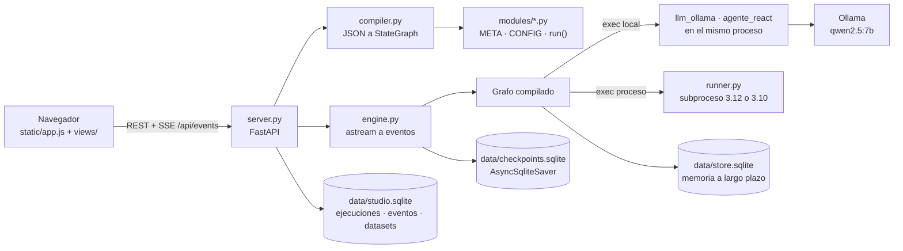

El núcleo es la pareja `compiler.py` + `engine.py`: el JSON del flujo se compila a un `StateGraph` en cada ejecución y el motor traduce el *stream* de LangGraph a eventos para la GUI. Por eso joins, ciclos, interrupts, checkpoints y bifurcaciones son los de LangGraph y no una reimplementación. La decisión de diseño con más consecuencias está en [`DISENO.md`](demo/studio/DISENO.md) §1: en Python 3.10 `interrupt()` falla dentro de nodos `async`, así que el servidor corre en 3.12 y los nodos que necesitan torch 2.4 (voz, retrato, lip-sync) se lanzan como subprocesos de un segundo intérprete 3.10. Como cada uno vive en su propio grupo de procesos, «Detener» los puede matar a mitad de trabajo.

## Puesta en marcha

### Requisitos

- **Linux** (`arrancar.sh` usa `ss` y `hostname -I`)
- **Python 3.12**
- **[Ollama](https://ollama.com/download)** en marcha, con unos **5 GB de disco** para `qwen2.5:7b` y `nomic-embed-text`
- Unos **330 MB** para el entorno virtual

### Instalación

```bash
git clone https://github.com/femogo/studio_stadio.git
cd studio_stadio/demo/studio

ollama pull qwen2.5:7b
ollama pull nomic-embed-text

python3 -m venv .venv-studio
.venv-studio/bin/pip install -r requirements.txt
.venv-studio/bin/playwright install chromium-headless-shell   # solo para los tests de la GUI
cp settings.example.json settings.json

.venv-studio/bin/python -m pytest -q
```

Si todo está bien verás esto:

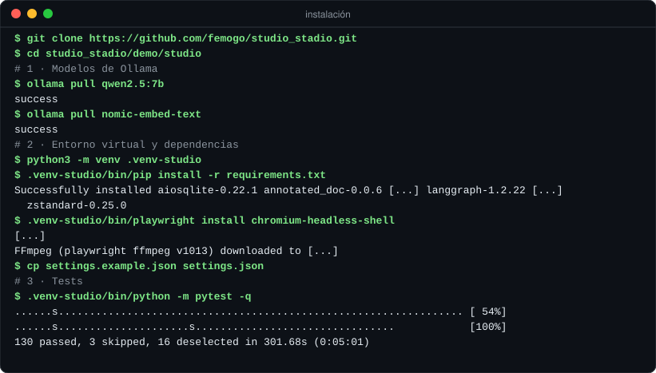

> [!IMPORTANT]
> - El entorno virtual tiene que llamarse **`.venv-studio`** y estar dentro de `demo/studio/`: `arrancar.sh` y los nodos que corren en subproceso lo buscan ahí.
> - Los tests tardan unos **5 minutos** porque arrancan servidores de verdad en los puertos 8798 y 8799. Los 3 saltados necesitan el entorno de vídeo o sus retratos, que no están en el repositorio (ver «Sobre el proyecto»).
> - `arrancar.sh` deja el servidor en segundo plano escuchando en `0.0.0.0:8790`. Si otro programa ya ocupa ese puerto, el script dice «Ya está en marcha» y no arranca nada: cambia `port` en `settings.json`. Para no exponerlo en la red, pon `host` a `127.0.0.1`.

## Recorrido paso a paso

El estudio se usa desde el navegador, así que cada paso es un flujo de uso con su pantallazo. Los flujos son las plantillas que trae el repositorio, con `qwen2.5:7b`; las ejecuciones de las capturas se lanzaron por la API REST, que es la misma que usa la GUI. Las capturas de terminal son salidas reales recortadas donde aparece `[...]`. Los tiempos dependen de tu máquina y el texto que escribe el modelo cambia de una ejecución a otra.

### Paso 1 · Arrancar el estudio y crear un flujo

```bash
./arrancar.sh
```

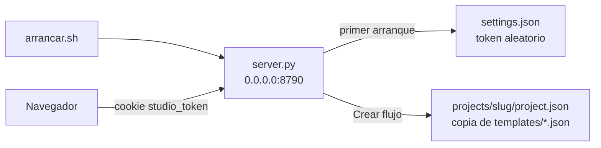

El script imprime la URL y el token, que se genera solo en el primer arranque y queda en `settings.json` (no se sube al repositorio). Abre la URL, pega el token y llegarás a Inicio: el estado de la máquina arriba, tus flujos y tus agentes debajo. «Crear flujo» ofrece seis plantillas; las tres de la captura son las de los pasos siguientes. Un **agente** es un flujo con nombre, contexto propio y versiones: «Asistente de Laura» es el flujo «Asistente personal» con `usuario = laura`.

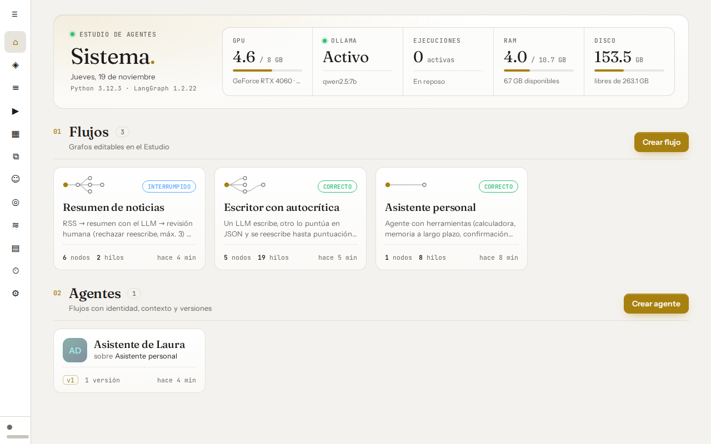

### Paso 2 · Ejecutar un flujo con un ciclo

En el Estudio, «▶ Iniciar» con la entrada `{"tema": "Hernán Cortés y la caída de Tenochtitlan"}`.

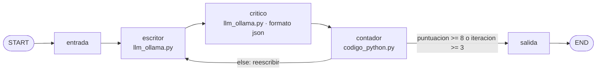

Las dos aristas que salen de `contador` son expresiones de Python guardadas en el JSON ([`templates/escritor_critico.json`](demo/studio/templates/escritor_critico.json)) que el compilador convierte en `add_conditional_edges`. La salida es la captura que abre este README. Fíjate en los contadores `×3` de los nodos y en la Historia: `#4 contador → escritor` y `#7 contador → escritor` son las dos vueltas atrás.

Lo habitual, sin embargo, es que no dé vueltas: en 12 ejecuciones desde el estudio el crítico puso un 8 a la primera en 9. Depende mucho del tema: con el de Lepanto del paso 8 reescribió en 3 de 5. Un crítico del mismo tamaño que el escritor es indulgente; el paso 7 vuelve sobre esto.

### Paso 3 · Volver atrás, cambiar un valor y bifurcar

En la pestaña Historia, elige `#3 critico → contador`, cambia `"puntuacion": 7` por `9` en Valores y pulsa «✎ Editar y bifurcar».

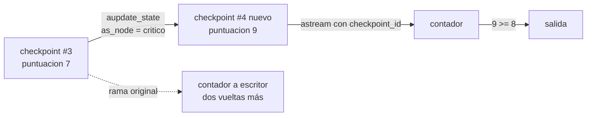

El servidor escribe el cambio como si lo hubiera producido el nodo que escribió ese checkpoint (`as_node = critico`), así que LangGraph vuelve a evaluar sus aristas con el valor nuevo. Fíjate en el árbol: la rama original (#5 a #11) queda sangrada y la nueva sale de `#4 __update__` y va directa a `salida`. Ningún nodo LLM se vuelve a ejecutar: el lienzo marca `×1` solo en Contador y Salida.

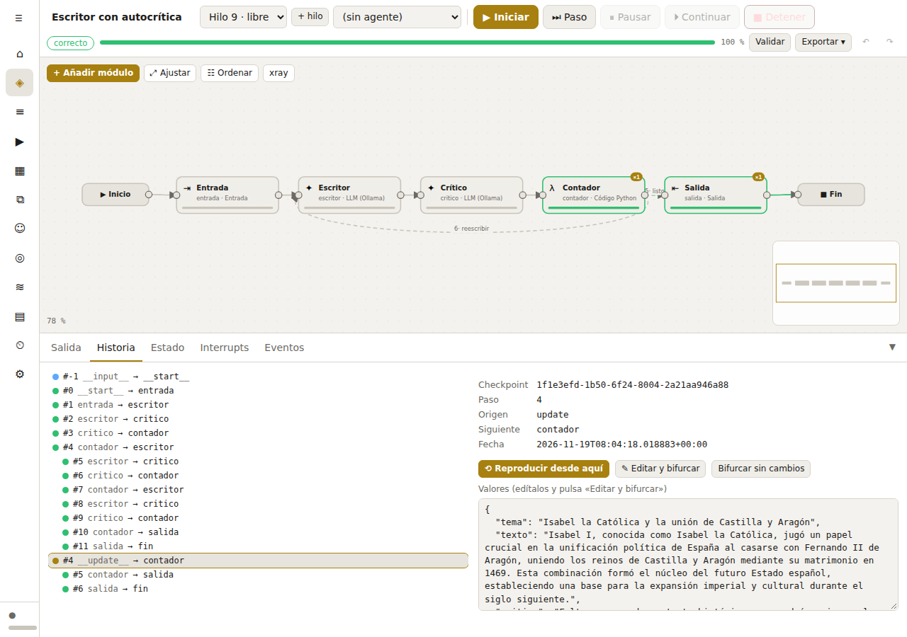

### Paso 4 · Pedir aprobación a una persona

Plantilla «Resumen de noticias (RSS)», con la entrada `{"url_rss": "https://feeds.elpais.com/mrss-s/pages/ep/site/elpais.com/section/tecnologia/portada", "palabras": 60}`.

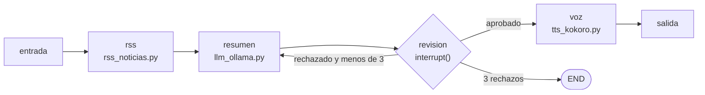

El nodo `revision_humana` llama a `interrupt()` y la ejecución termina en estado «interrumpido»: el hilo queda guardado en los checkpoints y puedes contestar horas después desde la pestaña Interrupts. En la captura ya se rechazó el primer borrador, que resumía cinco noticias, con el comentario «Demasiado largo. Quédate solo con la noticia del mercado laboral y la IA, en dos frases». Fíjate en que la segunda versión obedece a medias: son dos frases, pero sobre dos noticias.

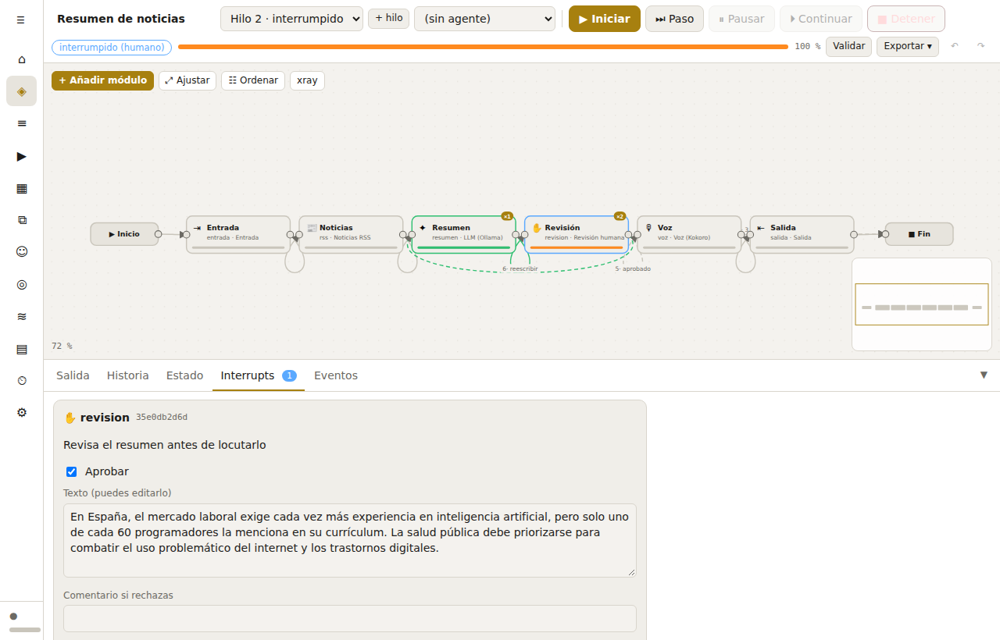

> Si apruebas, el siguiente nodo es `Voz (Kokoro)`, que necesita el entorno de vídeo. Sin él la ejecución termina en error con `FileNotFoundError`; el resumen aprobado queda en el estado del hilo.

### Paso 5 · Un agente con herramientas y memoria entre conversaciones

En el Estudio de «Asistente personal», elige el agente «Asistente de Laura» y pulsa «💬 Chat». En un hilo: *«Me llamo Laura y soy alérgica al marisco. Apúntatelo.»* En otro hilo nuevo, lo que ves en la captura.

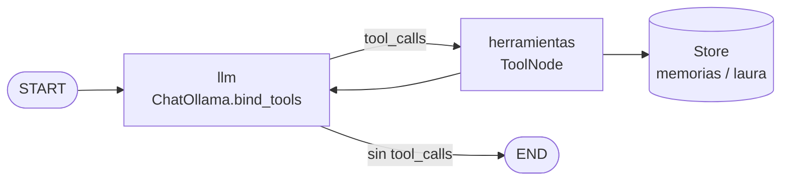

El nodo `agente_react` no usa `create_react_agent`: el compilador monta el subgrafo LLM ⇄ herramientas en `_build_agent`. El contexto del agente (`usuario = laura`) elige el espacio de nombres de la memoria, y la memoria vive en el Store, no en el hilo. Fíjate en la primera respuesta: es un hilo nuevo, sin historial, y el agente decide por su cuenta llamar a `consultar_memoria` antes de contestar. En la segunda usa la calculadora en vez de hacer la cuenta él.

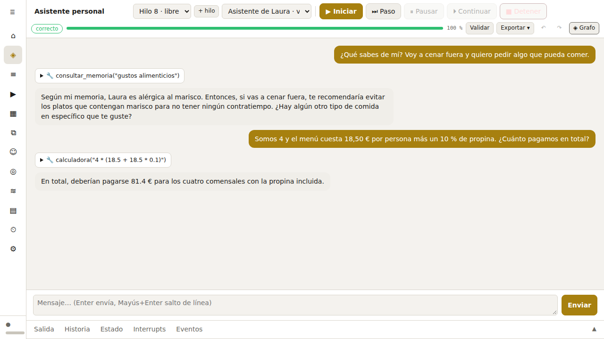

Con frases menos directas el modelo de 7B falla: a *«¿Te acuerdas de cómo me llamo?…»* contestó sin consultar la memoria, y a *«Hola, me llamo Laura. Soy alérgica al marisco…»* no guardó nada.

### Paso 6 · Escribir un nodo nuevo

Módulos → «Editar» (o «+ Nuevo módulo», que parte de un esqueleto).

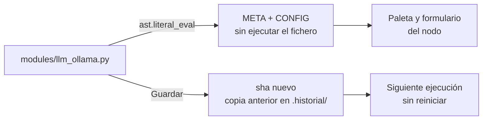

Un nodo es un fichero Python con un diccionario `META` (tipo, entradas, salidas, si usa GPU, si corre en el proceso o en un subproceso), una lista `CONFIG` que se convierte en el formulario del nodo y una función `run(state, cfg, ctx)`. `META` y `CONFIG` se leen con el árbol sintáctico, sin importar el módulo, de modo que un fichero roto no tumba el servidor: queda marcado con el error y su línea. Cada vez que guardas, la versión anterior se copia en `modules/.historial/`.

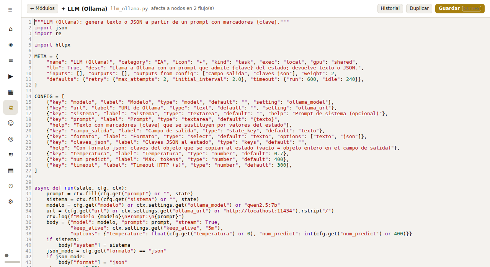

### Paso 7 · Evaluar un flujo con un dataset

Datasets → «+ Nuevo», cinco temas como ejemplos y «▶ Nuevo experimento» con tres evaluadores:

```text
nota_critico     (expresión)  output.get('puntuacion', 0) >= 8
max_80_palabras  (expresión)  len(output.get('texto', '').split()) <= 80
juez_tema        (juez LLM)   ¿El párrafo trata el tema pedido y sus datos históricos son correctos?
```

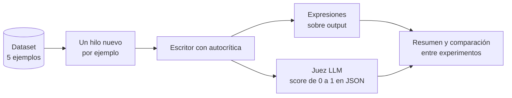

Cada ejemplo corre como una ejecución normal (se puede abrir con «Hilo») y los evaluadores puntúan su salida. El resultado sale casi perfecto y eso es lo que hay que leer con cuidado: el crítico da 8 casi siempre y el juez, que es el mismo `qwen2.5:7b`, puso 0,80 a cuatro de cinco. En la captura del paso 8 el escritor sitúa Lepanto en el «Estrecho de Corinto» (fue en el golfo de Patras), el error sigue en la versión final y el crítico le da un 8. En otra ejecución con ese tema el escritor se pasó al chino a mitad de párrafo y también sacó un 8. Para detectar eso hacen falta ejemplos con `expected` y un juez más capaz que el modelo evaluado.

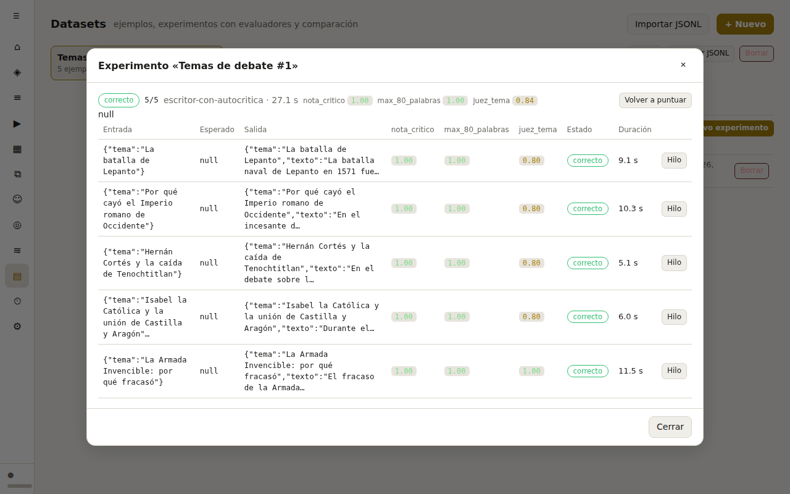

### Paso 8 · Exportar el flujo y ejecutarlo sin el estudio

Con el estudio en marcha (o desde «Exportar ▾» en el Estudio):

```bash
TOKEN=$(python3 -c "import json;print(json.load(open('settings.json'))['token'])")
curl -s -H "X-Token: $TOKEN" -o escritor.zip \
  "http://127.0.0.1:8790/api/projects/escritor-con-autocritica/export?format=py"
unzip -q escritor.zip && cd export_escritor-con-autocritica
python3 -m venv .venv && .venv/bin/pip install -r requirements.txt
.venv/bin/python ejecutar.py
```

Donde `ejecutar.py`, dentro de esa carpeta, es:

```python
import asyncio
from langgraph.checkpoint.memory import InMemorySaver
import graph as G

app = G.graph.builder.compile(checkpointer=InMemorySaver())

async def main():
    cfg = {"configurable": {"thread_id": "1"}}
    async for paso in app.astream({"tema": "La batalla de Lepanto"}, cfg, stream_mode="updates"):
        for nodo, cambios in paso.items():
            print(f"{nodo:9} → {cambios}")

asyncio.run(main())
```

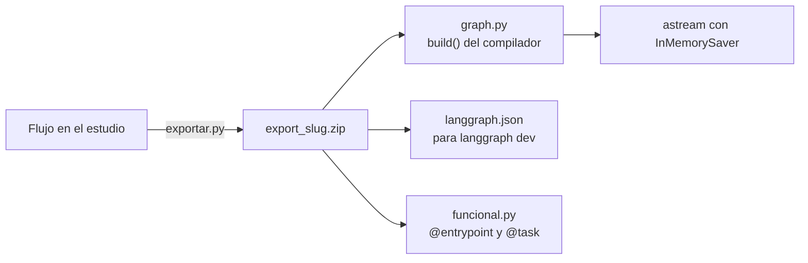

El ZIP lleva el compilador del estudio (`studio_runtime/`), los módulos que usa el flujo, el JSON del proyecto y un `requirements.txt` con las versiones exactas. `graph.py` no compila con *checkpointer*: lo pone quien lo sirve (`langgraph dev`) o tú, como en el script. Fíjate en que esta ejecución sí dio dos vueltas (7, 7 y 8) y en el error de geografía del primer párrafo del que habla el paso 7.

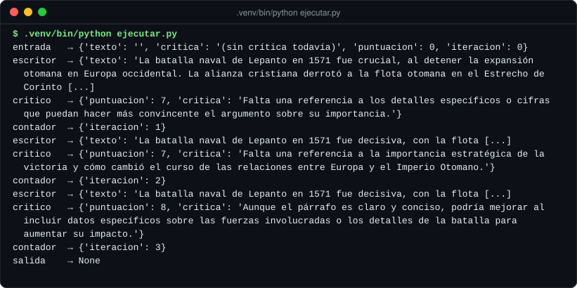

> El nodo Contador corre en subproceso con el intérprete del estudio: la exportación escribe su ruta en el `settings.json` del ZIP. Si lo llevas a otra máquina, ajusta `python_estudio` ahí.

## Tests

```bash
.venv-studio/bin/python -m pytest -q          # 130 tests, unos 5 minutos
.venv-studio/bin/python -m pytest -q -m llm   # 10 tests más con Ollama real, unos 2,5 minutos
```

Los marcadores están en [`pytest.ini`](demo/studio/pytest.ini): `llm` y `gpu` quedan fuera por defecto. Los 6 de `gpu` generan voz, retratos y vídeo de verdad y no se han ejecutado para este README.

| Fichero | Qué comprueba |
|---|---|
| `test_spike_lg.py`, `test_spike_f2.py`, `test_spike_f3.py` | Que las APIs de LangGraph 1.2 se comportan como asume el diseño: *drain* con un interrupt pendiente, cancelar sin repetir tareas, bifurcar con `aupdate_state`, `TimeoutPolicy` con *heartbeat*, `error_handler` tras los reintentos |
| `test_modules.py` | Lectura de `META`/`CONFIG` por AST, errores de validación con su línea e imports prohibidos; protocolo de `runner.py` |
| `test_compiler.py` | Aristas condicionales, joins, ciclo con límite de recursión, timeouts, cancelar mata el subproceso, la GPU exclusiva espera |
| `test_engine.py` | Pausar y continuar sin repetir nodos, detener, *breakpoints*, interrupt y reanudación, reconciliación tras reiniciar |
| `test_api.py` | Token obligatorio, versiones e importación de flujos, estado e historia por SSE, bifurcar y copiar hilos, reinicio sin perder datos |
| `test_f2_api.py`, `test_f2_modulos.py` | Agentes versionados, reejecutar un nodo, estrategias de *double-texting*, caché con TTL, `Send`, `Command`, subgrafos, Store, RSS y HTTP |
| `test_f3_api.py`, `test_f3_export.py`, `test_f3_debate.py` | Datasets, experimentos, programaciones con cron, *playground* de prompts, MCP, exportación (`graph.py` y API funcional) y la plantilla de debate |
| `test_d9_flujos.py` | Un flujo usado como herramienta del agente |
| `test_ui.py`, `test_f2_ui.py`, `test_f3_ui.py`, `test_d9_ui.py` | La GUI con Playwright: todas las rutas sin errores de consola, editar el lienzo y deshacer, guardar un módulo y usarlo sin reiniciar, responder un interrupt |
| `test_f2_llm.py`, `test_f3_llm.py`, `test_d9_llm.py` (`-m llm`) | Router, memoria entre hilos, chat con calculadora, juez LLM, MCP y flujo como herramienta con `qwen2.5:7b` |

## Estructura

```
demo/
  generar_clip.py              Script de vídeo original (guion, voz, retrato, lip-sync, montaje)
  studio/
    server.py                  API REST, SSE, token y arranque
    compiler.py                Flujo JSON → StateGraph de LangGraph
    engine.py                  Ejecuciones, eventos, pausa, parada y double-texting
    modules.py                 Descubrimiento y validación de módulos por AST
    runner.py                  Ejecuta un módulo en subproceso (protocolo @@P/@@S/@@R)
    db.py                      SQLite, ajustes y flujos en disco
    assistants.py              Agentes: contexto y configuración versionados
    f3.py                      Evaluadores, crons y playground
    exportar.py                ZIP con graph.py, langgraph.json y funcional.py
    modules/                   Los 21 tipos de nodo (LLM, router, agente, RSS, voz, vídeo…)
    modules/tools/             Herramientas del agente: calculadora, memoria, confirmación
    templates/                 Las seis plantillas de flujo
    static/                    GUI sin build: app.js, views/ y CodeMirror vendorizado
    tests/                     Tests con servidor real, Playwright y spikes de LangGraph
    DISENO.md                  Documento de diseño (fases F1–F3 y decisiones)
    legacy/                    Versión 1 del estudio, archivada
```

## Problemas frecuentes

| Síntoma | Causa y solución |
|---|---|
| `Falta el token o no es válido` | La API exige el token. Está en `settings.json`; en la GUI se pide una vez y se guarda en una cookie |
| `Ya está en marcha en el puerto 8790` y la URL no responde | Otro programa usa ese puerto. Cambia `port` en `settings.json` y vuelve a lanzar `./arrancar.sh` |
| `EmptyInputError: Received no input for __start__` | Lanzaste una ejecución por la API sin `input`. Para empezar con los valores del nodo Entrada manda `{"input": {}}` |
| `FileNotFoundError` en Voz, Retrato, Lip-sync, Montaje o Concatenar | Son nodos del intérprete pesado (`demo/.venv`, Python 3.10 con torch), que no se instala con este README |
| `ParseError: not well-formed` en el nodo Noticias | La URL no devuelve RSS ni Atom (le pasaba al feed de RTVE que traía antes la plantilla). Cambia `url_rss` |
| `Connection refused` en el puerto 11434 | Ollama no está arrancado: `ollama serve` |
| `model "qwen2.5:7b" not found` | Falta `ollama pull qwen2.5:7b` (o `nomic-embed-text` para la memoria) |
| Algo falla y la GUI no dice por qué | `arrancar.sh` deja el log del servidor en `demo/studio/server.log` |

## Sobre el proyecto

Herramienta personal, de un solo usuario, construida en tres fases a partir de un documento de diseño: [`DISENO.md`](demo/studio/DISENO.md) recoge el objetivo, las decisiones (D1–D9), lo que se verificó de LangGraph antes de escribir código y los criterios de aceptación de cada fase. Está escrito para que una sesión de Claude Code lo implementara leyendo solo ese documento, y antes pasó por una revisión de varios agentes revisores que está en [`REVISION_EGM.md`](demo/studio/REVISION_EGM.md).

El punto de partida es `demo/generar_clip.py`, un script que genera el vídeo de un personaje histórico hablando a cámara. En el estudio ese proceso es una plantilla más («Clip de personaje» y «Debate histórico»), y la versión 1 está archivada en `legacy/`. Esas plantillas usan [SadTalker](https://github.com/OpenTalker/SadTalker), que no se incluye (`git clone https://github.com/OpenTalker/SadTalker.git demo/SadTalker`), y un segundo entorno Python 3.10 con torch, Kokoro y SDXL que tampoco está en el repositorio. Las imágenes y vídeos generados con IA no se publican.

**Autor:** Fernando Morales · [femogo.github.io](https://femogo.github.io) · [GitHub](https://github.com/femogo)
